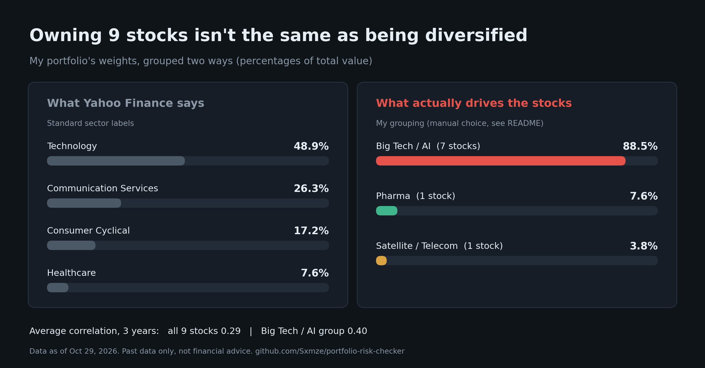

# Stock Portfolio Risk Checker

A Python tool that analyzes the risk in your stock portfolio using real market data. Built for beginners learning about portfolio risk and diversification.


*Example output showing risk analysis for a sample portfolio*

## What It Does

This tool helps you understand how risky your stock portfolio is by analyzing:

1. **Overall Portfolio Risk** - Measures your portfolio's volatility (how much it bounces around)
2. **Sector Concentration** - Shows if you're too heavily invested in one industry
3. **Risk Contribution** - Identifies which stocks are driving your portfolio's total risk
4. **Stress Testing** - Shows how your portfolio performed during market crashes

## Features

### Basic Risk Analysis
- Download real stock prices from Yahoo Finance (free)
- Calculate portfolio volatility and Value at Risk (VaR)
- Show correlation between your stocks
- Display data freshness timestamp

### Advanced Features
- **Stress View**: Find your worst days, worst month, and how stocks correlate during market crashes
- **Sector Breakdown**: Both Yahoo Finance sectors and custom risk-based groupings (e.g., "Big Tech / AI")
- **Risk Contribution**: Shows which stocks contribute more risk than their portfolio weight suggests

## Installation

### Prerequisites
- Python 3.8 or higher
- Internet connection (to download stock prices)

### Setup

1. Clone or download this repository

2. Install required packages:
```bash
pip install yfinance pandas numpy
```

Or use the requirements file:
```bash
pip install -r requirements.txt
```

## How to Use

### First Time Setup

The first time you run the program, it will use the example portfolio from `portfolio.example.json`. This lets you try the tool before entering your own stocks.

### Basic Portfolio Analysis

1. Run the main program:
```bash
python portfolio_risk.py
```

2. Add your stocks using the menu (example):
   - AAPL: 10 shares
   - MSFT: 5 shares
   - TSLA: 3 shares

3. Choose "Analyze risk" to see your portfolio's risk metrics

Your portfolio is saved in `portfolio.json` (excluded from git by default).

### Demo Mode (Privacy-Friendly)

Run in demo mode to hide share counts and dollar values (percentages only):

```bash
python portfolio_risk.py --demo
```

This is useful for:
- Sharing screenshots without revealing your actual holdings
- Learning how the tool works with example data
- Presenting the tool to others

### Advanced Analysis

Run individual feature scripts for detailed analysis:

```bash
# Stress testing - worst days and crisis correlations
python feature1_stress_view.py

# Sector breakdown with custom groupings
python feature2_sector_fixed.py

# Risk contribution analysis (1 year vs 3 years)
python feature3_risk_updated.py
```

## Example Output

For a sample portfolio of AAPL, MSFT, TSLA (worth $10,000):

```
Portfolio Volatility: 28.5% annually
Worst Single Day: -4.2% loss ($420)
Sector Concentration: Technology 85% ⚠️

Risk Contribution:
  TSLA: 15% of money, but 28% of risk (1.87x multiplier)
  AAPL: 50% of money, 48% of risk (0.96x)
  MSFT: 35% of money, 24% of risk (0.69x)
```

## How the Calculations Work

### Volatility
**What it measures:** How much your portfolio's value bounces up and down over time.

**How it works:** Calculate the standard deviation of daily returns (percentage changes), then multiply by √252 to annualize it. Higher volatility means more unpredictable returns.

### Correlation
**What it measures:** How much your stocks move together (0 = independent, 1 = move identically).

**How it works:** For each pair of stocks, measure how their daily returns move in relation to each other using statistical correlation. High correlation means less diversification benefit.

### Risk Contribution
**What it measures:** How much each stock adds to your total portfolio risk, accounting for both volatility and correlation.

**How it works:** Calculate each stock's contribution using the formula: (stock weight × covariance with portfolio) / portfolio variance. A stock can contribute more risk than its weight if it's highly correlated with your other holdings.

### Stress View
**What it measures:** How your portfolio behaves during market crashes.

**How it works:** Identify the market's (SPY) worst days, then measure how your stocks' correlations change on those crisis days compared to normal days. If correlations spike during crashes, your diversification disappears when you need it most.

## Project Structure

```
stock-risk-checker/
├── portfolio_risk.py              # Main interactive program
├── portfolio.json                 # Your saved portfolio (auto-created)
├── feature1_stress_view.py        # Stress testing analysis
├── feature2_sector_fixed.py       # Sector breakdown with custom groups
├── feature3_risk_updated.py       # Risk contribution (1yr & 3yr)
├── requirements.txt               # Python dependencies
└── README.md                      # This file
```

## Customizing Groupings

Edit the `CUSTOM_GROUPS` dictionary in `feature2_sector_fixed.py` to define your own risk-based groups:

```python
CUSTOM_GROUPS = {
    'Big Tech / AI': ['AAPL', 'MSFT', 'GOOGL', 'META', 'NVDA'],
    'Energy': ['XOM', 'CVX'],
    'Finance': ['JPM', 'BAC']
}
```

This grouping reflects *your* view of what actually drives stock prices, not just Yahoo Finance's sector labels.

## Limitations

**Important things this tool does NOT do:**

1. **Uses past data only** - All calculations are based on historical prices. Past volatility does not guarantee future volatility.

2. **Time period matters** - Results differ between 1 year and 3 years of data. A stock might look safe over 1 year but risky over 3 years, or vice versa. There's no single "correct" time period.

3. **Manual groupings** - The "Big Tech / AI" grouping is a subjective choice in the code. You can edit it, but it's not an objective categorization.

4. **Sample size issues** - Crisis correlation analysis needs lots of data. With only 25 crisis days in 1 year, results can be noisy. 3 years of data is more reliable but still limited.

5. **Does not predict prices** - This tool measures risk based on past behavior. It does not predict future stock prices or tell you what to buy or sell.

6. **Does not account for** - Transaction costs, taxes, dividends, options, leverage, or other advanced portfolio features.

## For Interviews

If you're explaining these concepts in an interview:

- **Volatility**: "I measure how much daily returns vary using standard deviation, then scale to annual."
- **Correlation**: "I calculate pairwise correlations to see if stocks move together or independently."
- **Risk contribution**: "I use the covariance matrix to measure each stock's marginal contribution to total portfolio variance."
- **Stress view**: "I identify market crash days and measure if stock correlations spike during those periods."

## Troubleshooting

**"ModuleNotFoundError: No module named 'yfinance'"**
- Run: `pip install yfinance pandas numpy`

**"No data found for ticker XXX"**
- Check that you entered a valid stock ticker (use all caps)
- Some international stocks may not be available

**"Analysis takes a long time"**
- Normal - downloading a year of data for 9 stocks takes 30-60 seconds

## Contributing

This is a learning project. Feel free to:
- Add new risk metrics
- Improve the visualization
- Add support for different asset classes
- Create better grouping algorithms

## License

MIT License - Use this for learning, projects, or interviews.

## Disclaimer

This tool is for educational purposes only. It does not constitute financial advice. Always do your own research and consult a financial advisor before making investment decisions.
